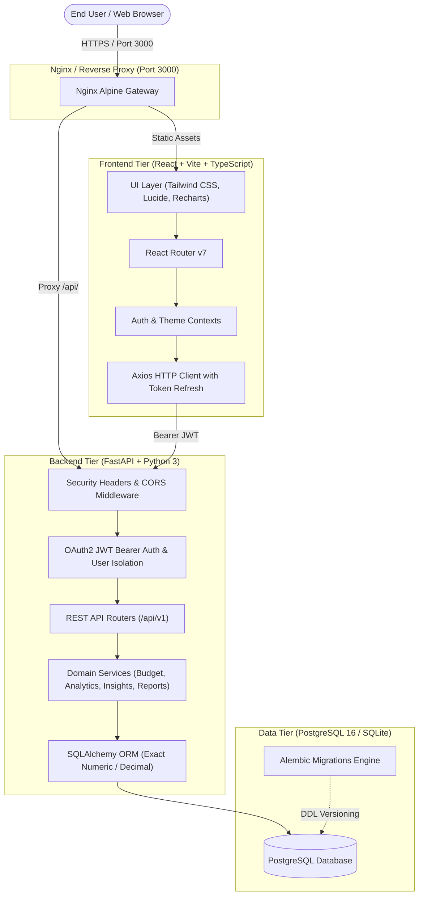

# Smart Expense Calculator – Architecture Specification

## 1. System Overview

**Smart Expense Calculator** is an enterprise-ready personal finance platform constructed using a decoupled, modern multi-tier architecture. It enforces strict user data isolation, exact decimal arithmetic for financial accounting, and modular business logic engines.

---

## 2. Architectural Pillars

### A. Non-Floating-Point Monetary Arithmetic
Floating-point arithmetic (IEEE 754) introduces cumulative rounding anomalies (e.g. `0.1 + 0.2 = 0.30000000000000004`). In this system:
- **Database Layer**: Every currency column uses `NUMERIC(12, 2)` or `DECIMAL(12, 2)` ensuring exact precision up to 999,999,999.99.
- **Backend Model Layer**: Python standard library `decimal.Decimal` is used across all calculations, aggregations, and services.
- **Serialization Layer**: Pydantic models validate and format all currency amounts with exact two-decimal point precision.

### B. User-Level Multi-Tenant Data Isolation
Every financial record is strictly scoped to `user_id`. The database schema defines foreign key relationships with `CASCADE` deletes, and the query repository pattern ensures that every `SELECT`, `UPDATE`, or `DELETE` executes with an enforced `WHERE user_id = current_user.id` constraint. Users cannot view, enumerate, or modify transactions belonging to any other user.

### C. Authentication & Token Lifecycle
1. **Password Hashing**: User credentials are protected using **Argon2id**, the winner of the Password Hashing Competition (PHC), providing state-of-the-art resistance against GPU/ASIC brute-force attacks.
2. **Access Tokens**: Short-lived JWTs (24 hours default) signed with HS256 containing user subject (`sub`), token type (`access`), and UTC expiration (`exp`).
3. **Refresh Tokens**: Long-lived tokens (7 days default) stored in the database as SHA-256 hashes (`token_hash`), enabling secure session revocation on logout and preventing database token exposure.
4. **Automatic Client Refresh**: The Axios interceptor detects HTTP 401 status codes, buffers pending requests, exchanges the refresh token for a fresh access token transparently, and retries the failed request without disrupting the user session.

---

## 3. Modular Service Architecture

- **AuthService**: Handles registration, Argon2 verification, session token generation, token refresh, and cryptographic password reset workflows.
- **BudgetService**: Evaluates overall and category-level monthly allocations against live expenses, calculating utilization percentages and generating 80% and 100% threshold breach alerts.
- **SavingsService**: Tracks target milestones, automates remaining days and needed monthly allocations, and updates goal progression upon verified contribution deposits.
- **DashboardService**: Aggregates filtered period incomes, expenses, net savings, budget utilization, and historical 6-month trends.
- **AnalyticsService**: Evaluates weekly day-of-week spending habits, daily spend averages, and period-over-period comparison deltas.
- **InsightsService**: Modular rule-based engine examining MoM category spikes, income-to-expense ratios, budget allowances, and savings pace to calculate an objective Financial Health Score (0-100).
- **ReportService**: Generates audit-grade financial statements, streamable CSV spreadsheets, and publication-ready PDF documents using ReportLab.
