# Smart Expense Calculator – Database Schema Documentation

## 1. Entity-Relationship Overview

The database follows a normalized relational architecture enforcing primary keys, foreign key constraints, unique indexes, and user-level data segregation.

```mermaid
erDiagram
    USERS ||--o{ INCOMES : "records"
    USERS ||--o{ EXPENSES : "incurs"
    USERS ||--o{ CATEGORIES : "defines"
    USERS ||--o{ BUDGETS : "allocates"
    USERS ||--o{ SAVINGS_GOALS : "targets"
    USERS ||--o{ REFRESH_TOKENS : "owns"
    CATEGORIES ||--o{ INCOMES : "categorizes"
    CATEGORIES ||--o{ EXPENSES : "categorizes"
    CATEGORIES ||--o{ BUDGETS : "applies_to"
    SAVINGS_GOALS ||--o{ SAVINGS_CONTRIBUTIONS : "receives"

    USERS {
        int id PK
        string email UK
        string hashed_password
        string full_name
        string currency
        numeric monthly_income_target
        boolean is_active
        boolean is_verified
        timestamp created_at
        timestamp updated_at
    }

    CATEGORIES {
        int id PK
        int user_id FK "nullable for system default"
        string name
        string type "income or expense"
        string icon
        string color
        boolean is_system
        timestamp created_at
        timestamp updated_at
    }

    INCOMES {
        int id PK
        int user_id FK
        int category_id FK
        string title
        numeric amount "12, 2"
        date date
        string payment_method
        text description
        timestamp created_at
        timestamp updated_at
    }

    EXPENSES {
        int id PK
        int user_id FK
        int category_id FK
        string title
        numeric amount "12, 2"
        date date
        string payment_method
        text description
        text notes
        timestamp created_at
        timestamp updated_at
    }

    BUDGETS {
        int id PK
        int user_id FK
        int category_id FK "nullable for overall"
        numeric amount "12, 2"
        int month
        int year
        int alert_threshold "default 80"
        timestamp created_at
        timestamp updated_at
    }

    SAVINGS_GOALS {
        int id PK
        int user_id FK
        string name
        numeric target_amount "12, 2"
        numeric current_amount "12, 2"
        date target_date
        string category
        text notes
        string status "in_progress, completed, paused"
        timestamp created_at
        timestamp updated_at
    }

    SAVINGS_CONTRIBUTIONS {
        int id PK
        int goal_id FK
        int user_id FK
        numeric amount "12, 2"
        date date
        text notes
        timestamp created_at
    }

    REFRESH_TOKENS {
        int id PK
        int user_id FK
        string token_hash UK
        timestamp expires_at
        boolean revoked
        timestamp created_at
    }
```

---

## 2. Table Specifications

### `users`
| Column | Type | Constraints | Description |
| :--- | :--- | :--- | :--- |
| `id` | `INTEGER` | `PRIMARY KEY AUTOINCREMENT` | Unique identifier |
| `email` | `VARCHAR(255)` | `UNIQUE, NOT NULL, INDEXED` | User email address |
| `hashed_password` | `VARCHAR(255)` | `NOT NULL` | Argon2id password hash |
| `full_name` | `VARCHAR(150)` | `NOT NULL` | User full name |
| `currency` | `VARCHAR(10)` | `NOT NULL, DEFAULT 'USD'` | Reporting currency symbol/code |
| `monthly_income_target` | `NUMERIC(12, 2)` | `NULLABLE` | Optional personal income target |
| `is_active` | `BOOLEAN` | `DEFAULT TRUE` | Account active status |
| `is_verified` | `BOOLEAN` | `DEFAULT TRUE` | Verification flag |
| `created_at` | `TIMESTAMPTZ` | `DEFAULT NOW()` | Record creation timestamp |
| `updated_at` | `TIMESTAMPTZ` | `DEFAULT NOW()` | Record update timestamp |

### `categories`
| Column | Type | Constraints | Description |
| :--- | :--- | :--- | :--- |
| `id` | `INTEGER` | `PRIMARY KEY AUTOINCREMENT` | Unique identifier |
| `user_id` | `INTEGER` | `FOREIGN KEY (users.id) CASCADE, NULLABLE` | Owner user ID (NULL for default system categories) |
| `name` | `VARCHAR(100)` | `NOT NULL` | Category label |
| `type` | `VARCHAR(20)` | `NOT NULL` | `'income'` or `'expense'` |
| `icon` | `VARCHAR(50)` | `NULLABLE` | UI icon token |
| `color` | `VARCHAR(20)` | `NULLABLE` | Hex badge color |
| `is_system` | `BOOLEAN` | `DEFAULT FALSE` | Pre-seeded default category indicator |

### `expenses`
| Column | Type | Constraints | Description |
| :--- | :--- | :--- | :--- |
| `id` | `INTEGER` | `PRIMARY KEY AUTOINCREMENT` | Unique identifier |
| `user_id` | `INTEGER` | `FOREIGN KEY (users.id) CASCADE, INDEXED` | User association |
| `category_id` | `INTEGER` | `FOREIGN KEY (categories.id) SET NULL, INDEXED` | Category reference |
| `title` | `VARCHAR(200)` | `NOT NULL` | Expenditure title / merchant |
| `amount` | `NUMERIC(12, 2)` | `NOT NULL` | Exact monetary transaction value |
| `date` | `DATE` | `NOT NULL, INDEXED` | Incurred transaction date |
| `payment_method` | `VARCHAR(50)` | `NOT NULL` | Payment tender (Card, Cash, etc.) |
| `description` | `TEXT` | `NULLABLE` | Transaction detail |
| `notes` | `TEXT` | `NULLABLE` | Optional remarks |

### `incomes`
| Column | Type | Constraints | Description |
| :--- | :--- | :--- | :--- |
| `id` | `INTEGER` | `PRIMARY KEY AUTOINCREMENT` | Unique identifier |
| `user_id` | `INTEGER` | `FOREIGN KEY (users.id) CASCADE, INDEXED` | User association |
| `category_id` | `INTEGER` | `FOREIGN KEY (categories.id) SET NULL, INDEXED` | Income stream category |
| `title` | `VARCHAR(200)` | `NOT NULL` | Revenue stream title |
| `amount` | `NUMERIC(12, 2)` | `NOT NULL` | Exact monetary value |
| `date` | `DATE` | `NOT NULL, INDEXED` | Date received |
| `payment_method` | `VARCHAR(50)` | `NOT NULL` | Deposit method |
| `description` | `TEXT` | `NULLABLE` | Detailed notes |

### `budgets`
| Column | Type | Constraints | Description |
| :--- | :--- | :--- | :--- |
| `id` | `INTEGER` | `PRIMARY KEY AUTOINCREMENT` | Unique identifier |
| `user_id` | `INTEGER` | `FOREIGN KEY (users.id) CASCADE, INDEXED` | User association |
| `category_id` | `INTEGER` | `FOREIGN KEY (categories.id) CASCADE, NULLABLE` | Scope (NULL = overall monthly budget) |
| `amount` | `NUMERIC(12, 2)` | `NOT NULL` | Budget ceiling amount |
| `month` | `INTEGER` | `NOT NULL (1 - 12)` | Budget target month |
| `year` | `INTEGER` | `NOT NULL` | Budget target year |
| `alert_threshold` | `INTEGER` | `DEFAULT 80` | Warning percentage trigger threshold |

Unique Constraint: `(user_id, category_id, month, year)`.

### `savings_goals` & `savings_contributions`
- `savings_goals`: Holds goal target amount, current saved amount, deadline date, status (`in_progress`, `completed`, `paused`).
- `savings_contributions`: Stores audit history for every individual deposit towards a goal, automatically updating `savings_goals.current_amount`.
